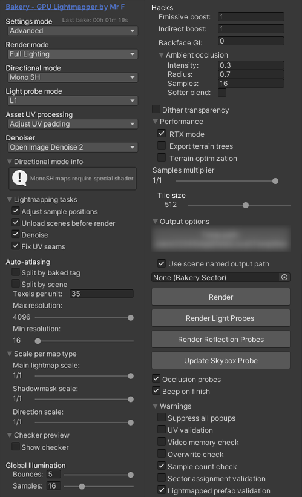

# ライティングの再ベイク

内装の改変やオブジェクトを追加した場合に、ライティングを再計算（ベイク）する手順です。

---

## Bakery でベイクする場合

Bakery - GPU Lightmapper を導入している場合の推奨設定です。

1. メニューバーの **Bakery > Render Lightmap** を開きます。
2. **Render Mode** や **Resolution** をシーンの規模に合わせて調整します（既定値は同梱設定を参照）。
3. **Render** を実行してベイクを開始します。

---

## ビルトインライトマッパーでベイクする場合

ビルトインライトマッパー版のシーンは、Unity 標準の Progressive CPU/GPU Lightmapper で再ベイクします。導入後に一度再ベイクした状態が、意図した見た目です。

1. **Window > Rendering > Lighting** を開きます。
2. **Generate Lighting** を実行してベイクを開始します。
