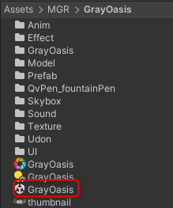

# 導入

[必要環境](index.md)を確認してから始めてください。

STEP 1
<h3>プロジェクトを作成する</h3>

VCC（VRChat Creator Companion）または ALCOM から、VRChat ワールド用の新規プロジェクトを作成します（Unity 2022.3.22f1）。

STEP 2
<h3>必須アセットを導入する</h3>

ワールド内のギミックやシェーダーが参照しているため、パッケージをインポートする前に、次のアセットを導入してください。Bakery は任意です。

| アセット | 用途 | 入手先 |
|---|---|---|
| VizVid | ビデオプレイヤー | [VPMリポジトリ](https://xtlcdn.github.io/vpm/) |
| QvPen | ペンギミック | [VPMリポジトリ](https://vpm.ureishi.net/install) |
| VRC Light Volumes | アバターライティング | [GitHub](https://github.com/REDSIM/VRCLightVolumes) |
| Visitors Information Board | 入退室ログ表示 | [BOOTH](https://booth.pm/ja/items/5403376) |
| Mochies-Unity-Shaders | 水・エフェクト用シェーダー | [GitHub](https://github.com/MochiesCode/Mochies-Unity-Shaders) |
| Bakery - GPU Lightmapper | ライティングベイク（任意） | [Unity Asset Store](https://assetstore.unity.com/packages/tools/level-design/bakery-gpu-lightmapper-122218?locale=ja-JP) |

!!! tip "Bakery を導入していない場合"
    Bakery を導入していない場合は、同じパッケージに入っているビルトインライトマッパー版のシーンを使用できます。

STEP 3
<h3>unitypackage をインポートする</h3>

1. [7-Zip](https://www.7-zip.org/) をインストールします。7-Zip は無料の展開ソフトです。すでにインストールしている場合は、手順 2 に進みます。
2. 購入データの `GRAY_OASIS_v1.2.1_1of2.zip` と `GRAY_OASIS_v1.2.1_2of2.zip` を、同じフォルダに展開します。`GRAY_OASIS_v1.2.1.zip.001` と `GRAY_OASIS_v1.2.1.zip.002` ができます。
3. `GRAY_OASIS_v1.2.1.zip.001` を右クリックして、7-Zip の**ここに展開**を選びます。メニューに 7-Zip が見当たらない場合は、**その他のオプションを表示**を選びます。
4. できた `GRAY_OASIS_v1.2.1.unitypackage` を、プロジェクトにインポートします。

シーンとテクスチャは、すべてこのパッケージに入っています。

STEP 4
<h3>シーンを開く</h3>

**Project** ウィンドウから次のシーンを開きます。

- Bakery 版: `Assets/MGR/GrayOasis/GrayOasis.unity`
- ビルトインライトマッパー版: `Assets/MGR/GrayOasis/GrayOasis_builtinLightmapper.unity`

!!! note "ビルトインライトマッパー版は、導入後に再ベイクします"
    ビルトインライトマッパー版のライトマップは、Bakery を導入した環境でベイクしています。モデルのライトマップ用 UV は、Bakery の導入の有無で変わります。そのため、Bakery を導入していない環境では、一部のモデルでライトマップがずれて見えます。導入後に、[ライティングの再ベイク](customize.md)の手順で、再ベイクしてください。Bakery 版のシーンは、再ベイクが不要です。

STEP 5
<h3>動作確認とアップロード</h3>

1. Unity の Play モード（ClientSim）に入り、スポーン位置、ライティング、ギミックの動作を確認します。
2. 問題がなければ、VRChat SDK コントロールパネルの **Builder** タブで、ワールドのタイトル、説明文、サムネイル画像を設定します。
3. **Build and Upload** を実行します。

