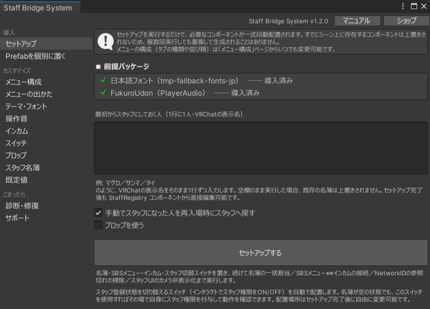

# 導入

[必要環境](index.md)を確認してから始めてください。

STEP 1
<h3>前提パッケージを導入する</h3>

VCC / ALCOM から [FukuroUdon](https://github.com/mimyquality/FukuroUdon)（`com.mimylab.fukuroudon`）を追加してください。**インカムを使わない場合も必要です。** 日本語表示用のフォントは依存パッケージとして一緒に入ります。

`Assets/TextMesh Pro/` が無い場合は、**Window > TextMeshPro > Import TMP Essential Resources** を実行してください。 

STEP 2
<h3>unitypackage をインポートする</h3>

ワールドプロジェクトにインポートします。`Assets/MGR/Udon/StaffBridgeSystem/` に展開されます。
`Prefabs`・`Audio`・`Samples`などのサブフォルダ構成は維持してください。

STEP 3
<h3>セットアップウィンドウを開く</h3>

メニューバーの **Tools > MGR > Staff Bridge System > セットアップ・カスタマイズ** を開きます。
先頭に前提パッケージの不足が表示された場合は、「導入ページを開く」から追加してください。

STEP 4
<h3>「セットアップする」を押す</h3>

必要に応じて最初からスタッフにしておく人の表示名を入力し、「セットアップする」を押します。

| 項目 | 入力・動作 |
|---|---|
| 最初からスタッフにしておく人 | VRChatの表示名を1行に1人ずつ入力。空欄なら既存の名簿を維持します |
| 手動でスタッフになった人を再入場時にスタッフへ戻す | 当日スタッフの付与を保存し、次のインスタンスでも復帰させます（既定ON） |
| プロップを使う | v1.2.0 以降。オンにすると、SBSメニューに「プロップ」タブが加わります（**既定はオフ**）。登録は[プロップ編集](reference.md#prop)で行います |

名簿・SBSメニュー・インカムの音声基盤・スタッフ切替スイッチが自動配置され、相互の接続が完了します。

STEP 5
<h3>動作を確認してアップロードする</h3>

1. 「診断・修復」で指摘を確認・修復します。
2. UnityのPlayモードで、名簿への登録または切替スイッチで自分をスタッフにしてメニューの開閉と操作を確認します（[操作ガイド](usage.md)）。
3. StaffRegistryの「ログ出力する」をOFFにしてアップロードします。

## ギミックを個別に追加する { #single-prefab }

「Prefab を個別に置く」ページのボタンから追加できます（スタッフ判定ギミックは1ワールドあたり最大128個）。配置と同時に名簿へ自動で接続されます。

| ボタン | 内容 |
|---|---|
| スタッフ切替スイッチ | 押すと自分がスタッフ ON/OFF になるスイッチ |
| スタッフ専用スイッチ | スタッフだけが操作できるスイッチ（スタッフ以外が押すと拒否メッセージが出る） |
| スタッフゲート | スタッフだけ通れる壁 |
| 頭上マーカー | スタッフの頭上に出す目印。置き場所は問いません（実行中は自動で頭上へ移動します） |
| 在室スタッフ一覧ボード | 入室中のスタッフ名を表示するボード |
| 共有タイマーボード | 共有タイマーの残り時間を表示するボード。見出しは配置後に Inspector で変えられる |
| ログボード | SBS に起きたことを時刻順に流すボード。板のボタンで種別を絞り、過去へさかのぼれる |

## 既存オブジェクトをスタッフ限定にする { #staff-only-existing }

Hierarchyでオブジェクトを選択し、右クリック > **GameObject > MGR > Staff Bridge System** から選びます。

| メニュー | 動作 |
|---|---|
| スタッフだけ見えるようにする > **Renderer・Collider 制御（標準）** | 自分の見た目・当たり判定を切り替える（音などは継続） |
| スタッフだけ見えるようにする > **GameObject.SetActive 制御（丸ごと）** | オブジェクトを丸ごと非アクティブにする（音の再生なども停止） |
| スタッフ以外だけ見えるようにする（スタッフには隠す） > **Renderer・Collider 制御（標準）** | 上記の逆。スタッフのときだけ見た目・当たり判定を隠す |
| スタッフ以外だけ見えるようにする（スタッフには隠す） > **GameObject.SetActive 制御（丸ごと）** | 上記の逆。スタッフのときだけ丸ごと非アクティブにする |
| **スタッフだけ押せるボタンにする** | 既存のインタラクトをスタッフ限定にする（Collider が無い場合は BoxCollider を自動で追加） |
| **スタッフだけ通れる壁（ゲート）にする** | スタッフ以外だけを通さない壁にする（Collider が無い場合は BoxCollider を自動で追加） |

同じ項目は **Tools > MGR > Staff Bridge System > 選択オブジェクトに追加** からも実行できます。

2つの制御方法の違いは [設定リファレンス](reference.md#staff-only-objects) を参照してください。

## 既存のワールドを更新する { #update }

更新の前に、プロジェクトのバックアップを取ってください。

1. 新しいunitypackageをプロジェクトへインポートします。
2. セットアップウィンドウの「診断・修復」を開きます。
3. 表示された項目のボタンを押します。項目は、メニューの使い方によって違います（[機能の届き方](#update-delivery)）。
4. ClientSimで、メニューの操作とインカムの通話を確かめます。

同梱のサンプルシーンを直接編集している場合は、インポートの前に別名で保存してください。インポートで上書きされます。

### メニューの使い方の見分け方 { #update-check }

- **Prefabのまま**: Hierarchyでメニューの名前が青色
- **アンパック等**: Hierarchyでメニューの名前が黒色

v1.0.0のセットアップで作ったメニューは「アンパック等」です。

### v1.2.0の機能の届き方 { #update-delivery }

| 機能 | Prefabのまま | アンパック等 |
|---|---|---|
| 周りの声を下げる | 「インカムを再リンク」を押すと接続されます | 「周りの声を下げるスライダーを追加」を押します。「基本」タブの一番下に「インカム使用中の周りの声」が入ります |
| プロップインベントリ | 使う場合だけ「プロップタブを追加」を押します | 使う場合だけ「プロップタブを追加」を押します |
| スイッチのカテゴリとお気に入り | インポートだけで、タブ列と★が加わります | [メニューを作り直す](#update-rebuild)と加わります |
| 設定のインカムタブの配置 | インポートだけで新しい配置になります | [メニューを作り直す](#update-rebuild)と新しい配置になります |

### Prefabのままの場合の警告 { #update-warning }

インポート直後に、「インカムの接続」で始まる警告と「周りの声を下げる（PA Supervisor接続）」が出ることがあります。

- 「インカムを再リンク」を押すと、どちらも解消します。
- 警告が残る場合は、「PA Supervisorへ接続」を押します。

### メニューを作り直す（アンパック等の場合） { #update-rebuild }

セットアップウィンドウの「メニュー構成」で、「この構成でメニューを作り直す」を押します。

- スイッチの設定は引き継がれます。
- メニューは新しいオブジェクトに置き換わります。見た目や階層を手で変えている場合、その変更は失われます。先にバックアップを取ってください。
- Ctrl+Zで元に戻せます。
- カテゴリやお気に入りを使わない場合、作り直す必要はありません。

### ★が表示されるタイミング { #update-star }

★は、IDが振られた行にだけ表示されます。IDは次のときに振られます。

- セットアップウィンドウの「スイッチ」ページを開いたとき
- ワールドをアップロードしたとき

IDが振られる前は、ClientSimで★が表示されません。

### v1.0.0から更新する場合 { #update-v100 }

「診断・修復」に「声の大きさの調整を追加」「前面表示に設定」が表示されたら、それぞれのボタンを押します。
