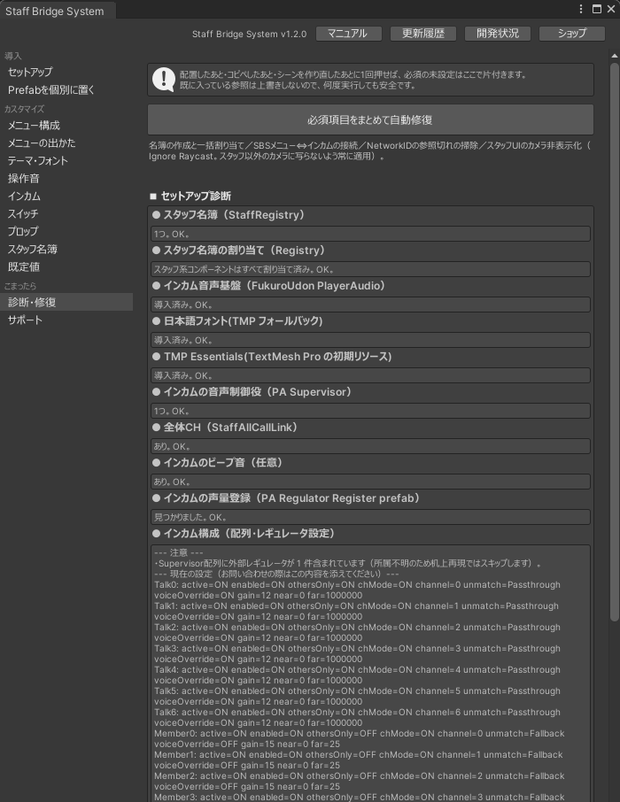
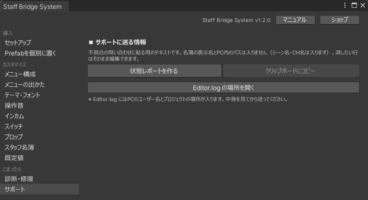

# トラブルシューティング

!!! tip "まずは診断を実行してください"
    **Tools > MGR > Staff Bridge System > セットアップ・カスタマイズ > 診断・修復** を開いて実行します。参照の設定漏れ、必須オブジェクトの不足、前提パッケージの未導入など、よくある不具合の多くはここで検出でき、ボタンで修復できます。

---

## メニューの文字が表示されない

**原因**: 日本語フォント `net.narazaka.vrchat.tmp-fallback-fonts-jp` が未導入です。

文字が豆腐（□）になるのではなく、フォント参照そのものが欠落した状態になります。すでに別の日本語TMPフォールバックを設定している環境でも、参照しているフォントアセットが異なるため代替にはなりません。

**対処**: VCC / ALCOMで導入してからシーンを再読み込みしてください。セットアップウィンドウの「導入ページを開く」ボタンからも配布元を開けます。

**導入済みなのに出ない場合**: TMP Essentialsが未インポートの可能性があります。`Assets/TextMesh Pro/` フォルダが無ければ、**Window > TextMeshPro > Import TMP Essential Resources** を実行してください。この状態は診断でも「TMP Essentials（TextMesh Pro の初期リソース）」の警告として検出されます。詳しくは [導入](install.md#tmp-essentials) を参照してください。

---

## メニューが開かない

- スタッフになっていない可能性があります。メニューはスタッフ状態のプレイヤーだけが開けます。一覧ボードや頭上マーカーで自分がスタッフになっているか確認してください。
- 長押しが足りていない可能性があります。既定では0.5秒の長押しが必要です。VRは右スティックを下に倒して長押し、Desktopは既定Tabキーの長押しです。
- Desktopキーが他のギミックと競合している場合は、`StaffMenuShell` の「Desktop開閉キー」を変更してください。

---

## メニューのボタンが押せない・反応しない

- ワールドのオブジェクトとボタンが重なっている可能性があります。開いたメニューは手前に描画されますが、当たり判定のあるオブジェクトの向こう側にあるボタンはレーザーが遮られて押せません。少し移動して開き直してください。

---

## メニューがワールドのオブジェクトに隠れて見えない

- 開いたメニューや視界の表示は、手前に描画されます。以前の版から更新したプロジェクトで反映されていない場合は、セットアップ窓の「診断・修復」の「メニューの前面表示設定」から「前面表示に設定」を実行してください。

---

## スタッフにならない

- 表示名が名簿と完全一致していないことが最も多い原因です。前後の空白、全角半角、絵文字の有無を確認してください。
- 名簿を編集した後、ワールドを再アップロードしていない可能性があります。名簿はワールドに焼き込まれます。
- 途中入室でも名簿による付与は働きます。反映されない場合は、誰かが入退室すると名簿が配り直されて揃うことがあります。
- 応急処置として、スタッフ切替スイッチでその場でスタッフにできます。

---

## インカムの音声が聞こえない

### 特定の人だけ聞こえない

その人が同じチャンネルに参加していない可能性が高いです。メニューのメンバー一覧で参加状況を確認してください。チャンネルを入り直すと復帰します。

チャンネル参加と名簿は、同期の取りこぼしを検出すると自動で再送する仕組みが入っています（3秒間隔で最大3分間）。それでも直らない場合はRejoinしてください。

### 全員聞こえない

- FukuroUdonが未導入のまま生成された可能性があります。診断で確認してください。
- 音声基盤（PA Supervisor）が複数存在すると、プレイヤータグを取り合って正しく動作しません。診断が複数検出した場合は1つに統合してください。

### スタッフ以外に聞こえてしまう

「スタッフ限定モード」がOFFになっていないか確認してください。この設定はワールドに焼き込まれるため、変更後は再アップロードが必要です。

「診断・修復」ページの「インカム聴こえ方マトリクス検査」で、設定した構成での聴こえ方をエディタ上で事前確認できます。

## インカム・メガホンの声が小さい・遠く感じる { #voice-small }

声は聞こえているが小さい場合、聞く人の設定とワールド設定の順に確認してください。

### 1. 聞く人の設定を確認する

- **[イヤーマフ](https://docs.vrchat.com/docs/vrchat-202222p3)**：減衰（外側の音量／Outside Volume）が0% だと範囲外の音がすべて遮断され、インカム等の音声も聞こえなくなります。オフにするか、最低でも5% 程度確保してください。
- **相手の個別音量**：クイックメニューで、相手の音量を個別に下げていないか確認します。
- **他の音声ギミック**：防音室など音量を変える他ギミックと同居していると、設定が上書きされる場合があります（[他ギミック使用時の停止](howto.md#pause-for-other-gimmick)）。

!!! note "イヤーマフはワールド側から解除・検知できません"
    VRChatのイヤーマフ処理はワールド側の音声制御よりも後の最終段階で適用されるため、ワールド側から設定の上書きや状態検知を行うことができません。範囲外のスタッフにも声を届ける必要がある場合は、イヤーマフの減衰を0% にせず、最低でも5% 程度確保する運用を推奨します。

### 2. 聞こえる音量（Voice Gain）を上げる

聞く側の設定に問題がなければ、届く音量（Voice Gain）を上げます（上限24 dB）。話す側のマイク音量ではなく、聞く側にどう聞こえるかの設定です。

- **ワールド全体の既定**：セットアップウィンドウの「インカム」ページ > 「インカムの声の大きさ（dB）」「メガホンの声の大きさ（dB）」で調整します（既定：インカム12、メガホン15）。
- **スタッフ各自の調整**：メニューの[設定タブ](usage.md#voice-gain) > 「インカム」で、自分に聞こえる音量を個別に増減できます（自分の話す声の音量は変わりません）。

## 周りの声が下がらない { #duck-not-working }

インカムやメガホンの使用中に周りの声を小さくする機能が動作しない場合は、以下の順に確認してください。

1. **減衰量が「下げない」になっていないか**：設定の「インカム」タブ最下部にある「使用中の周りの声」が右端の「下げない」のときは、音量は変わりません。スライダーを動かして、下げる量を指定してください（[使い方](usage.md#duck)）。ワールドの既定値が1 dB以下の場合は、下げる余地がないため、スライダーを操作できません。
2. **診断・修復で接続切れが発生していないか**：セットアップウィンドウの「診断・修復」に「周りの声を下げる（PA Supervisor接続）」が出ている場合は、「PA Supervisorへ接続」を押してください。「周りの声を下げる設定」が出ている場合は、機能のコンポーネントが未追加です（[既存のワールドを更新する](install.md#update)）。
3. **声の制御が無効化されていないか**：「周りの声を下げる（声の大きさの制御）」が出ている場合は、PA SupervisorのEnable Player Voice Controlが無効です。有効にしたあと、再入場してください。有効にすると、周りの声が下がるようになります。無効のまま入場すると、スライダーを操作できないことがあります。インカムを一時停止している間も、この制御は無効になります。
4. **併用不可能な外部ギミックが存在しないか**：防音室など、参加者の声の大きさを操作する他のギミックとは併用できません（[他ギミック使用時の停止](howto.md#pause-for-other-gimmick)）。

特定の参加者の声だけが下がらない場合は以下を確認してください。

- **個別音量が設定されている参加者**：スタッフ限定モードで消音されている人や、ピックアップマイクを使用している人は、ワールド側で音量が個別制御されているため減衰しません。
- **Member 層の設定**：診断・修復で「周りの声を下げる（Member層の音声上書き設定）」を確認してください。チャンネル参加者を判別するMember層の声の上書きが有効なワールドでは、同層の参加者の声は減衰しません（設計意図として有効化している場合はそのままで問題ありません）。

※減衰対象はインカム・メガホンの発話者以外の声です。発話者本人の声、BGM、効果音、アバターの音は減衰しません。

## メニューを閉じるとインカムが使えない

インカム本体が常にActiveなGameObjectの下に置かれていない可能性があります。メニュー配下に置くと、メニューを閉じた時点で動作が止まります。

StaffIncomRadioを選択すると、Inspectorに注意書きが出ます。その場合は、メニューの外にある常にActiveなGameObjectへ手動で移動してください。

---

## インカム設置時に警告が出る

FukuroUdonの内部仕様の差異による不具合を防ぐため、動作確認済みのバージョン（3.19.5）のご利用を推奨します。

---

## 共有タイマーが開始できない・時間が増えない

**原因**: 名簿（StaffRegistry）が割り当てられていない可能性があります。同梱のPrefabを手で置いた構成では、Prefabがシーン内の名簿を参照として持てないため、配置後のリンクが必要です。

**対処**: **診断・修復ページ > 必須項目をまとめて自動修復** を実行してください。タイマーとスイッチへの名簿の割り当てもここで行われます。

共有タイマーの開始と取消は2回押しです。1回目でボタンの文言が変わり、既定5秒以内にもう一度押すと確定します。時間内に押さないと取り消されるため、1回しか押していない場合は始まりません。

---

## スイッチを押しても何も起きない

- イベント名が違う可能性があります。スペルミスや大文字小文字の違いはコンパイルエラーにならず、無音で失敗します。スイッチページの 「イベント名」 を送り先の実装と突き合わせてください
- 他の人の画面では何も起きない場合、それは仕様です。イベントが送られるのは押した本人のクライアントだけで、全員へ届けるかどうかは送り先が決めます。同梱の `StaffObjectToggle` なら 「同期する」 をONにしてください。それ以外のギミックは、そのギミック側の作りによります（[リファレンス](reference.md#trigger-global)）
- 途中から入室した人にも状態を反映したい場合は、送り先のギミックが対応しているか確認してください

---

## スイッチタブにカテゴリのタブや★が出ない・ずれる

- メニューをアンパック等でお使いの場合、旧バージョンから上書きインポートした直後は、タブと★が表示されません。セットアップウィンドウの「メニュー構成」から「この構成でメニューを作り直す」を実行してください。スイッチの設定内容は自動で引き継がれます（[リファレンス](reference.md#trigger-update)）。Prefabのままお使いの場合は、インポートだけで表示されます。
- 作り直したあとも★が表示されない場合は、セットアップウィンドウの「スイッチ」ページを一度開いてください。各行に行IDが自動採番されます
- カテゴリ名のタブが表示されない場合は、セットアップウィンドウの「スイッチ」ページ上部にある「カテゴリ一覧」に対象カテゴリ名が登録されているか確認してください。タブは一覧の名称と順序に連動します
- カテゴリタブを選択しても行が表示されない場合は、「行の振り分け」でその行が該当カテゴリの枠に入っているか、一覧の所属行数が0行 になっていないか確認してください。カテゴリ未選択の行は未分類となり「その他」タブに集約されます
- 10個目以降のカテゴリの行は「すべて」と「お気に入り」にのみ表示されます。カテゴリ数は9個以内に収めてください
- 行が0件のカテゴリタブが残る動作は仕様です。カテゴリ一覧に登録されている名称は所属行がなくてもタブに表示されます。不要なカテゴリは「スイッチ」ページのカテゴリ一覧から「×」を押して削除してください（所属行がある場合は確認ダイアログが表示され、行は未分類に戻ります）
- 行を並べ替えてもタブ順が変わらない動作は仕様です。タブの並び順は行順ではなくカテゴリ一覧の順序によって決まります。順番を変更する場合はカテゴリ一覧の「▲▼」操作を行ってください
- ★が以前と異なるスイッチに付与されている場合、行追加・アップロード後にUndo（元に戻す）操作を行ったか、別ワールドの設定ファイル（.asset）を読み込んだ可能性があります。同一の行IDが別行に割り当てられた場合、スタッフ端末の★表示が別行へ移行します。該当スタッフに★の再設定を依頼してください（[リファレンス](reference.md#trigger-category)）
- 1ページあたりの表示件数が14件に減少したのは、上部にカテゴリタブ列が追加されたためです。15件目以降は右端の▲▼ボタンでページを切り替えて操作できます

## プロップのタブが出ない・プロップが出せない { #prop-trouble }

- **タブが表示されない**：初期状態では無効化されています。次のいずれかで追加してください。(1) セットアップ画面で「プロップを使う」をチェックしてセットアップする。(2) メニュー構成ページで「プロップ」をONにして「この構成でメニューを作り直す」を押す。(3) プロップページで「メニューにプロップを追加する」を押す。(4) 診断・修復の「プロップタブ（未配置）」で「プロップタブを追加」を押す（[導入手順](install.md#prop-enable)）
- **出現ボタンが押せない**：操作にはスタッフ権限が必要です。また、グローバルボタンが「上限です」と表示されている場合は最大同時出現数に達しています。既存プロップを回収するか、設定で最大同時出現数を増やしてください
- **登録したオブジェクトが消えた**：プロップ登録時にシーン上の元オブジェクトは非アクティブ化されます。メニューから出現操作を行うと複製が生成・表示されます
- **ミラーに映らない**：ワールド内のミラーコンポーネント（VRC Mirror Reflection）のReflect LayersにWalkthroughレイヤーを含めてください（[設定リファレンス](reference.md#prop)）
- **他の参加者と位置が同期しない**：同期方式が「同期なし」のプロップをPickupで移動させると位置が食い違います。手に持って移動させるプロップはManual Object SyncまたはVRC Object Syncを指定してください

---

## 通知ログが出ない・邪魔になる

- 出るのはスタッフだけです。スタッフ状態を確認してください
- 各自の設定タブで「表示しない」を選んでいると出ません。位置は左下・左上から選べます。ミラーと重なる場合は切り替えてください。画面端で読みづらい場合は「表示位置を調整」で通知ログとノートの横・縦を個別に調整できます
- 人の出入りが多くて流れすぎる場合は、`StaffNoticeLog` の 「入退室を表示する」 をOFFにすると入退室が載らなくなります
- 1件あたりの表示時間は `StaffNoticeLog` の 「表示秒」（既定20）で変えられます

---

## テーマを適用しても色が変わらない

- プレイモード中は適用できません。プレイ中の変更はプレイ終了時に元へ戻るため、ボタンが無効化されます。
- 塗り替えはテーマの色と一致する要素のみを対象にします。生成時と別の色を手動で塗った要素は変更されません。

---

## アップロード時に警告ダイアログが出る

StaffRegistryの「ログ出力する」がONになっています。公開後もスタッフの表示名がConsoleに出続けるため、通常はOFFを推奨します。

警告のみで、アップロードはそのまま続行されます。

---

## Desktop のキーを押すと別の操作も一緒に動く

同じキーが2つの機能に割り当てられています。「診断・修復」ページの「Desktopキーの割り当て」が次を検出します。

| 検出するもの | 何が起きるか |
|---|---|
| メニュー開閉キーとの重複 | キー候補の `B` や `G` はメニューの開閉キーの選択肢にもあります。同じキーだと、押すたびにメニューが開閉しながら発話が始まります |
| VRChat 本体の操作との重複 | `V`（マイク）・`C`／`Z`・WASD・Space・Shift・Ctrl・Esc・Enter・Tab など。押すと本来の操作も一緒に動きます |
| キー候補どうしの重複 | 同じキーのボタンが設定タブに2つ並びます |
| 候補の1つ目が OFF でない | OFF を選んだつもりで発話キーが生きたままになります |
| インカムとメガホンの初期キーが同じ | 同じキーには両方を割り当てられないため、メガホン側が OFF で始まります |

キー候補は「既定値」ページから差し替えられます。

なお、インカムとメガホンに同じキーを選んだ場合は、あとから選んだ側が優先され、もう片方は自動でOFFになります。1回の押下で両方が動くのを避けるためです。

!!! note "予約キーの一覧は網羅ではありません"
    確実に重なるものだけを挙げています。ここに出ていないキーでも、VRChat側の操作と重なる可能性はあります。実機で一度お試しください。

---

## 生成や診断が動かない

フォルダの中身の構成を変えていると参照できません。`Prefabs` / `Audio` / `Samples` などのサブフォルダごと移動していないか確認してください。

インポートしたファイルの一部だけを削除している場合も同様です。unitypackageを再インポートして復元してください。

---

## 解決しない場合

BOOTHのメッセージ機能からご連絡ください。

セットアップウィンドウの右上に左から「マニュアル」「更新履歴」「開発状況」「BOOTH」のボタンがあり、左上にはバージョン表記（例：Staff Bridge System v1.2.0）が表示されます。不具合の問い合わせの際は、このバージョン表記をそのままお伝えください。

セットアップ窓の「サポート」ページにある 「サポートに送る情報」 で「状態レポートを作る」を押すと、調査に必要な情報が文章としてまとまります。「クリップボードにコピー」でコピーして、メッセージに貼り付けてください。

- レポートに含まれるもの
    - 本製品・Unity・VRChat SDK・FukuroUdonのバージョン
    - 診断結果
    - 設置数
    - チャンネル構成
    - 音声レギュレータの並び順
    - 名簿の件数
- **含まれないもの**: スタッフの表示名、PC内のパス、ワールドID
- シーン名・チャンネル名など、ご自身で付けた名前は含まれます。内容はその場で編集できるので、送りたくない行は消してからコピーしてください

レポートを作るボタンはシーンに何も書き込みません。外部への送信も行いません。

あわせて、Consoleに出ているエラーメッセージがあれば添えてください。

## VRの耳元操作（インカム／メガホン）が意図せず起動する・止まらない

設定タブの「VRの耳元操作」で、インカム（右手）とメガホン（左手）の操作方式を個別に変更できます。

- **PTT（長押し）**: トリガーを引いている間のみ送信します。
- **トグル**: トリガーを離しても送信が継続します。終了時はもう一度操作してください（方式を変更した際も停止します）。
- **OFF**: 誤操作を防ぐ場合はOFFに設定します。

## 視界HUDに発話者名が出ない

設定タブの「受信時の発話者名」を確認してください。

- **表示タイミング**: 誰かが話している間（受信中）のみ、帯が拡張して発話者名が表示されます。
- **待機中・送信中**: チャンネル番号のみの通常表示に戻ります。

## タイマーの通知音が聞こえない

設定タブの「通知音」が0になっていないか確認してください。音が鳴るのはタイマーが0に到達したときです。ストップウォッチの経過中には鳴りません。

## タイマー終了時にギミックが連動しない

以下の点を確認してください。

- **接続の確認**: Inspectorで `StaffOpsTimer` の「終了時トリガー」にシーン内の `StaffTrigger` が割り当てられているか。
- **設定行の確認**: 指定した「終了時トリガー番号」の行に、正しい発火先とイベント名が設定されているか。
- **実行権限**: 連動発火は共有タイマーのOwner（通常はタイマーを開始したクライアント）から1回のみ実行されます。
